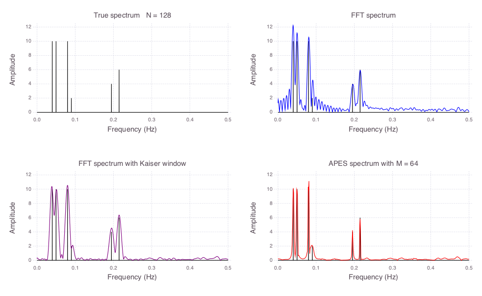

# Estimation

A julialang package for DSP related estimation

## Amplitude Estimation

- Amplitude and Phase Estimation of a Sinusoid (APES) [Jian Li, P. Stoica - An Adaptive Filtering Approach to Spectral Estimation and SAR Imaging (1996)](https://ieeexplore.ieee.org/document/506612).

## Frequency Estimation

- Quinn Fernandes
